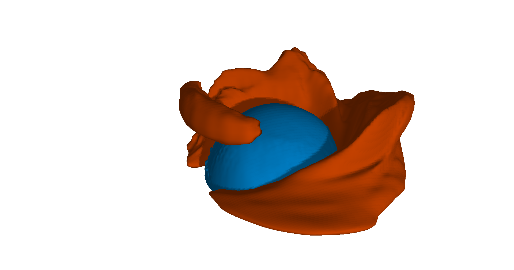

# TraitVis

Final year undergraduate project by Micheal Nestor. A tool for generating feature level-sets in arbitrary multifield datasets. Please reivew branch v1.0-dissertation-submission to see the state of the project at submission, it recieved a First Class clasification.

## Build Instructions

Premake is used for building.

Generate makefiles:

```
$ premake5 gmake
```

Release build:

```
$ make config=release
```

The binary is `./bin/Release/main`. Run it from the repository root so `assets/` resolves. A debug build is `make config=debug`, and `./bin/Debug/tests` runs the test suite.

## Loading Datasets

A dataset is a directory of attribute files plus a `config.txt`. Each attribute is a separate brick-of-floats binary, big-endian, and every attribute in one dataset has the same number of samples. The Hurricane Isabel dataset is one that TraitVis supports, and it can be downloaded [here](https://www.earthsystemgrid.org/dataset/isabeldata.html).

`NODATA` is optional. When it is present, that exact float value is treated as missing. `FILEPATH` is relative to the config file.


```
NAME:isabel-timestep-02
FILEPATH:./
SPATIALDOMAIN:500:100:500
DIMENSIONORDER:WIDTH_DEPTH_HEIGHT
INDEXSCHEME:ROWMAJOR
NODATA:1e35
DATASETSTRUCTURE:ATTRIBUTEPERFILE:25000000
ATTRIBUTE:CLOUDf02.bin:Total cloud:0:0.0032
ATTRIBUTE:Pf02.bin:Pressure:-5471.85791:3225.42578
ATTRIBUTE:PRECIPf02.bin:Precipitation:0:0.01672
ATTRIBUTE:QCLOUDf02.bin:Cloud moisture mixing ratio:0:0.00332
ATTRIBUTE:QGRAUPf02.bin:Graupel mixing ratio:0:0.01638
ATTRIBUTE:QICEf02.bin:Cloud ice mixing ratio:0:0.00099
ATTRIBUTE:QRAINf02.bin:Rain mixing ratio:0:0.01132
ATTRIBUTE:QSNOWf02.bin:Snow mixing ratio:0:0.00135
ATTRIBUTE:QVAPORf02.bin:Water vapor mixing ratio:0:0.02368
ATTRIBUTE:TCf02.bin:Temperature (Celsius):-83.00402:31.51576
ATTRIBUTE:Uf02.bin:X wind speed:-79.47297:85.17703
ATTRIBUTE:Wf02.bin:Y wind speed:-9.06026:28.61434
ATTRIBUTE:Vf02.bin:Z wind speed:-76.03391:82.95293
ATTRIBUTE:velocity.bin:Wind Velocity:0:67.467170
```

Paste the path to `config.txt`, or use Browse, then Load Dataset. Loading runs in the background; Cancel load stops it. Several datasets can be loaded, and the trait controls follow the one selected under Datasets.

## Generating Feature Level-Sets

Tick the attributes that belong in the trait. Each slider moves in that attribute's own units, and the histogram under it shows how the samples are distributed. Add attribute vertex records the current sliders as one trait point. Load Vertex copies a saved point back into the sliders. The distance slider is a percentage of the normalised attribute space: 0 is the trait point itself, 100 is as far as the space extends.

Choose a colour and a unique name, then Generate Feature Level Set. A surface with no vertices means no sample falls inside that distance. Close surface at missing data keeps the sheet where real samples meet missing ones, which on Isabel is the coastline. Uncheck it to leave those holes open. Keep distance field stores the field so the Distance slider on that level set can re-slice it without computing the field again.

Undo and Redo cover trait points, adding and removing level sets, and edits to colour, transparency, and distance.

Two surfaces on Isabel. The orange surface shows areas of high wind velocity, and the blue surface shows areas of low pressure.



## Viewing

Space captures the mouse. WASD moves, Q and E move up and down, and Escape closes the window. The same camera values can be typed in Camera Controls.

Each level set can be hidden, removed, or exported as OBJ. Import OBJ reads a mesh back in. Transparency from 0 to 1 peels nested surfaces from front to back; Depth layers caps how many of those layers are drawn. Show boundary vertices marks samples inside and outside the trait. Invert Normals flips the shading.

Screenshot writes the 3D view, without the panels, to a PNG.

The Rendering Parameters panel has ambient and diffuse colour, a directional light, and an optional point light. The point light is a cube you can move, including Move to camera pos. Shadows, off unless enabled, darken surfaces behind shells; Shadow floor keeps a shadowed surface from going flat. Enable the clip plane to drop everything on one side of an X, Y, or Z slice. Draw Wireframes and Back Face Culling are there as well.
