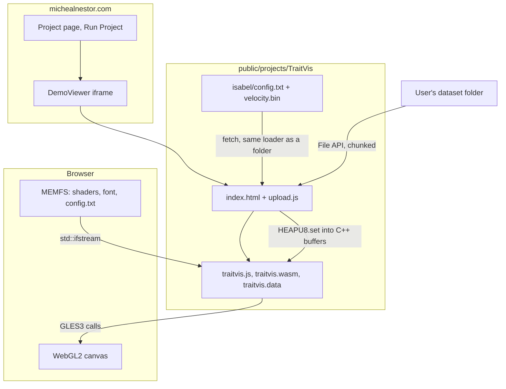

# TraitVis — WebGL / WebAssembly Porting Plan

The desktop refactors that make this port realistic are already in the tree. This document is the remaining work: toolchain, Premake `Web` configuration, GLES/WebGL2 differences in the renderer, browser dataset loading, and deployment to `michealnestor.com`.

Agents should treat this file as the source of truth. Do not re-do items marked done in §3. Do not invent a second `web_main.cpp` or a second parser in JavaScript.

Companion: [IMPLEMENTATION_PLAN.md](IMPLEMENTATION_PLAN.md). Item numbers such as 6.8 refer to that plan.

## Contents

1. [Feasibility](#1-feasibility)
2. [Architecture](#2-architecture)
3. [What is already done, and what is not](#3-what-is-already-done-and-what-is-not)
4. [Toolchain](#4-toolchain)
5. [Build configuration](#5-build-configuration)
6. [Rendering: desktop GL → GLSL ES 3.00 / WebGL2](#6-rendering-desktop-gl--glsl-es-300--webgl2)
7. [Loading datasets in the browser](#7-loading-datasets-in-the-browser)
8. [Memory and performance](#8-memory-and-performance)
9. [Web page and JavaScript glue](#9-web-page-and-javascript-glue)
10. [Testing the web build](#10-testing-the-web-build)
11. [Deployment](#11-deployment)
12. [Risks](#12-risks)
13. [Order of work](#13-order-of-work)

---

## 1. Feasibility

| Component | Status | Notes |
| --- | --- | --- |
| GLM | Works | Header-only. |
| Dear ImGui 1.90.4 in `third_party` | Works, bump required | `imgui_impl_glfw` + `imgui_impl_opengl3` support Emscripten. 1.90.4 has `ImGui_ImplGlfw_InstallEmscriptenCanvasResizeCallback`. Newer ImGui replaces it with `ImGui_ImplGlfw_InstallEmscriptenCallbacks` (wheel and focus as well as resize). Bump before calling the page done; first compile can use the 1.90.4 callback. |
| Marching cubes, distance field, parser, `MultiField` | Works | Pure C++. Already the `core` library. |
| `std::filesystem`, `std::chrono` | Work | Emscripten's libc++ is current. Do not add `<format>` on the web path; `shaderProgram.cpp` already has an unused include of it on desktop. |
| GLFW | Replace | `--use-port=contrib.glfw3`. It is GLFW 3.4 in C++. The built-in `-sUSE_GLFW=3` is a 2013 JavaScript GLFW 3.2.1 and is not to be used. |
| GLAD | Drop on web | Emscripten provides `<GLES3/gl3.h>`. |
| OpenGL | GLES 3.00 / WebGL2 | Desktop stays **4.6 core** so `assets/distanceField.comp` still runs. Web is GLES 3.0. Vertex and fragment shaders are ES-compatible once the version line is injected and sampler precision is set. Compute shaders do not exist in WebGL2; `GpuDistanceField` already returns `nullopt` under `__EMSCRIPTEN__`. |
| Threads (`std::jthread`; OpenMP since Emscripten 6.0.x) | Optional | Need `-pthread`, `SharedArrayBuffer`, and COOP/COEP. Ship single-threaded first. `DistanceFieldJob::step` and `DatasetReadJob::stepOnMainThread` already exist for that. |
| Filesystem | Split | Config, shaders, and the font go in MEMFS / `--preload-file`. Attribute `.bin` files are streamed into C++ buffers (§7). |
| Google Test | Native primary; wasm under Node as a compile/behaviour check | Several tests currently spin on `start()` + `finished()`. Without pthreads that hangs (§10). |

**Verdict: feasible.** Hard constraints are wasm32's 4 GB ceiling and the single-threaded default. Both are already designed for. The remaining work is platform glue and a handful of WebGL2 API differences that will silently produce a blank or incomplete picture if ignored.

---

## 2. Architecture



Three things differ from desktop, and each is isolated:

| Concern | Desktop | Web | Lives in |
| --- | --- | --- | --- |
| Frame loop | `while (!app.shouldClose()) app.frame();` | `emscripten_set_main_loop_arg(...)` | `src/main/main.cpp` — **already done** |
| GL header, GLSL version header | `<glad/glad.h>`, `#version 330 core` in the files today | `<GLES3/gl3.h>`, injected `#version 300 es` plus precision | `src/platform/gl.hpp` plus `ShaderProgram` |
| Dataset bytes | `readFloatBinaryFile` | buffers filled by JavaScript | `AttributeBytesProvider` already exists; web impl + JS glue do not |

No `web_main.cpp`. `Application` already owns `init` / `frame` / `shutdown`.

Keep `#ifdef __EMSCRIPTEN__` in `src/platform/`, `src/main/main.cpp`, `Application::init` (context hints), and the few GLES substitutes in `application.cpp`. Do not scatter new web-only logic through `core`.

---

## 3. What is already done, and what is not

Do not reimplement these. They are in the tree and the desktop tests cover them.

| Item | State | Where |
| --- | --- | --- |
| P2 `core` static library, no GL includes | Done | `premake5.lua` project `core` |
| 2.3 `ScalarField` (layout + `vector<float>`) | Done | `src/lib/levelSets/scalarField.hpp` |
| 2.4 `DistanceFieldJob::step(n)` | Done | `distanceField.hpp`. Web currently calls `stepOnMainThread(1)` from `pollLevelSet` — too few slabs; see §8.2 |
| 2.5 `FILEPATH` resolved against the config directory | Done | `configParser.cpp` |
| 4.2 `glPolygonMode` compiled out on web | Done | `application.cpp`, `gui.cpp`. Wireframe checkbox is `#ifndef __EMSCRIPTEN__` |
| 4.7 diagnostics returned, not printed, from `core` | Done | `DatasetDirConfig::error`, `MultiField::error` |
| 6.7.6 `GpuMesh` + `ShaderProgram` RAII, version-header injection | Done | VBO stays alive with its VAO. `ShaderProgram` prepends `kGlslHeader` for `.vert` / `.frag`. `distanceField.comp` keeps `#version 430 core`. |
| 6.8 `AttributeBytesProvider` | Done | `datasetReader.hpp`. Desktop default still goes through `readFloatBinaryFile` |
| 6.9 `SessionState` / `RenderState` | Done | |
| 6.10 `Application` | Done | `src/main/application.cpp` |
| Clip via `discard`, not `gl_ClipDistance` | Done | `litSurface.frag` |
| Compute shader desktop-only | Done | `gpuDistanceField.cpp` is an empty stub under `__EMSCRIPTEN__` |
| Canvas screenshot | Done | `downloadCanvasPng()` in `screenshot.cpp` |
| Emscripten main loop | Done | `src/main/main.cpp` |
| `DatasetReadJob::stepOnMainThread` / `LevelSetJob::stepOnMainThread` | Done | `start()` is a no-op without pthreads, which is the intended web path |

Still to do, and only this, is the rest of this document. Commit 1 (platform header, version injection, `setDrawBuffer`, desktop context stays 4.6) is done.

- Premake `Web` configuration, correctly scoped
- GLES behaviour still to prove on a real WebGL2 context: occlusion-query early-out, depth blit from the default framebuffer. `setDrawBuffer` already routes `glDrawBuffer` to `glDrawBuffers` under Emscripten.
- web dataset C API that uses `beginDatasetLoad` and the existing byte-swap
- `web/shell.html`, `upload.js`, sample fetch
- wasm Node test helper so jobs do not hang
- portfolio copy

`Sanitize` (ASan/UBSan) is named in the implementation plan and is **not** in `premake5.lua`. Only `Debug`, `Release`, and `ThreadSanitize` exist. The wasm Node test run is a Web filter, not a Sanitize filter.

---

## 4. Toolchain

```bash
git clone https://github.com/emscripten-core/emsdk.git ~/emsdk
cd ~/emsdk && ./emsdk install 4.0.14 && ./emsdk activate 4.0.14
source ~/emsdk/emsdk_env.sh
emcc --version     # must print 4.0.14
```

Pin **one** version in `README.md` and in CI. `contrib.glfw3` tracks the Emscripten release. Do not write "latest" in one place and `4.0.14` in another. Bump both together if a newer SDK is needed.

ImGui: after the first successful `emmake make`, bump `third_party/imgui` to a release that provides `ImGui_ImplGlfw_InstallEmscriptenCallbacks` (1.91+) and switch the call. Until then, 1.90.4's canvas-resize callback is enough to get a window on screen.

---

## 5. Build configuration

Premake's generated Makefiles honour `CC`, `CXX` and `AR`. `emmake` sets those. The web build is a Premake **configuration**, not a second build system.

Workspace-level flags that every project can share (optimisation, SIMD, glfw port):

```lua
workspace "TraitVis"
    configurations { "Debug", "Release", "ThreadSanitize", "Web" }
    -- existing Debug / Release / ThreadSanitize filters stay

    filter "configurations:Web"
        defines { "NDEBUG" }
        optimize "On"
        buildoptions { "-msimd128", "--use-port=contrib.glfw3" }
        linkoptions  { "--use-port=contrib.glfw3" }
    filter {}
```

Linker flags that export `_main`, preload assets, or pick a shell **must not** sit on the workspace. They belong only on `project "main"`. Putting them on the workspace applies them to `core`, `tests`, `read_binary`, and `read_multifield`. `tests` would then fail to link (`_traitvisBeginAttribute` undefined) and §10 would be impossible.

```lua
project "main"
    -- existing includedirs / links / files stay as the desktop default

    filter "configurations:Web"
        targetname "traitvis"
        targetextension ".html"
        removeincludedirs { "third_party/glfw/include" }
        removelinks { "glfw3", "X11", "Xrandr", "Xinerama", "Xi", "Xxf86vm", "Xcursor", "dl", "GL", "pthread" }
        removefiles { "third_party/glad/src/glad.c" }
        linkoptions {
            "-sMIN_WEBGL_VERSION=2", "-sMAX_WEBGL_VERSION=2",
            "-sALLOW_MEMORY_GROWTH=1", "-sMAXIMUM_MEMORY=4GB",
            "-sSTACK_SIZE=1MB",
            "-sEXPORTED_RUNTIME_METHODS=['ccall','cwrap','FS','HEAPU8']",
            "-sEXPORTED_FUNCTIONS=['_main','_malloc','_free','_traitvisBeginAttribute','_traitvisCancelPending','_traitvisDescribeConfig','_traitvisBeginLoad']",
            "--preload-file %{wks.location}/assets@/assets",
            "--shell-file %{wks.location}/web/shell.html",
        }
    filter {}
```

`targetname "traitvis"` is required. The C++ target is currently `main`, so the default outputs are `main.html` / `main.js` / `main.wasm` / `main.data`. Renaming those files after the build breaks the JS loader, which hard-codes the wasm and data names.

Premake runs the link from `_build_/main`, so `--preload-file assets` and `--shell-file web/shell.html` are wrong. Use `%{wks.location}`.

`removeincludedirs { "third_party/glfw/include" }` is required. Leaving it in place shadows the port's `GLFW/glfw3.h`.

```lua
project "tests"
    filter "configurations:Web"
        removeincludedirs { "third_party/glfw/include" }
        removelinks { "pthread" }
        linkoptions { "-sNODERAWFS=1" }
    filter {}
```

`core` needs no extra Web filter beyond the workspace SIMD / glfw-port flags (and glfw is unused by `core` anyway; `--use-port` on a static lib is harmless if it compiles). Do not export C functions or preload assets on `core` or `tests`.

```bash
# scripts/build_web.sh
set -euo pipefail
source ~/emsdk/emsdk_env.sh
premake5 gmake
emmake make config=web core main
python3 -m http.server 8080 --directory bin/Web
```

`file://` does not work for wasm. Serve the directory.

Notes:

- Do **not** add `-sFULL_ES3=1`. It emulates client-side vertex arrays we do not use.
- `-sMAXIMUM_MEMORY=4GB` is the wasm32 ceiling. `-sMEMORY64` is slower and less widely supported; skip it.
- `--preload-file` is shaders and the font only. Datasets stay out of `traitvis.data`, including the sample in §7.3.
- `EXPORTED_FUNCTIONS` must list every `EMSCRIPTEN_KEEPALIVE` symbol the page calls, with a leading underscore.
- If Premake fights the flags, fall back to a small `web/CMakeLists.txt` that builds `core` + `main`. Try the configuration first.

---

## 6. Rendering: desktop GL → GLSL ES 3.00 / WebGL2

### 6.1 One platform header

```cpp
// src/platform/gl.hpp
#pragma once
#ifdef __EMSCRIPTEN__
    #include <GLES3/gl3.h>
    #include <emscripten.h>
    inline constexpr const char* kGlslHeader =
        "#version 300 es\n"
        "precision highp float;\n"
        "precision highp sampler2D;\n"
        "precision highp sampler2DArray;\n";
    inline constexpr const char* kImGuiGlslVersion = "#version 300 es";
    inline void setDrawBuffer(GLenum buffer) {
        const GLenum buffers[] = { buffer };
        glDrawBuffers(1, buffers);
    }
#else
    #include <glad/glad.h>
    inline constexpr const char* kGlslHeader = "#version 330 core\n";
    inline constexpr const char* kImGuiGlslVersion = "#version 130";
    inline void setDrawBuffer(GLenum buffer) { glDrawBuffer(buffer); }
#endif
```

Every file that currently includes `<glad/glad.h>` includes this instead: `shaderProgram.hpp` / `.cpp`, `gpuMesh.cpp`, `gpuDistanceField.cpp`, `gui.cpp`, `screenshot.cpp`. `application.cpp` picks it up through `shaderProgram.hpp`. GLFW stays a separate include.

`precision highp sampler2DArray` is required. `sampler2DArray` has no default precision in GLSL ES 3.00, so `litSurface.frag` will not compile without it. `precision highp sampler2D` is required for the peel-depth texture: the default for `sampler2D` is `lowp`, which is not enough for a depth comparison.

Replace every `glDrawBuffer(...)` in `application.cpp` with `setDrawBuffer(...)`. GLES3 has `glDrawBuffers` only. `glReadBuffer` exists and can stay.

### 6.2 Context: desktop stays 4.6, web is GLES 3.0

Do **not** drop the desktop context to 3.3. `GpuDistanceField` requires GL 4.3 compute shaders and `computeShadersAvailable()` checks the version. `Application::init()` currently requests 4.6 core; keep that on desktop.

```cpp
#ifdef __EMSCRIPTEN__
    glfwWindowHint(GLFW_CLIENT_API, GLFW_OPENGL_ES_API);
    glfwWindowHint(GLFW_CONTEXT_VERSION_MAJOR, 3);
    glfwWindowHint(GLFW_CONTEXT_VERSION_MINOR, 0);
#else
    glfwWindowHint(GLFW_CONTEXT_VERSION_MAJOR, 4);
    glfwWindowHint(GLFW_CONTEXT_VERSION_MINOR, 6);
    glfwWindowHint(GLFW_OPENGL_PROFILE, GLFW_OPENGL_CORE_PROFILE);
    if (!gladLoadGLLoader(reinterpret_cast<GLADloadproc>(glfwGetProcAddress))) return false;
#endif
    ImGui_ImplOpenGL3_Init(kImGuiGlslVersion);
#ifdef __EMSCRIPTEN__
    ImGui_ImplGlfw_InstallEmscriptenCanvasResizeCallback("#canvas");
    // after the ImGui bump: ImGui_ImplGlfw_InstallEmscriptenCallbacks(window, "#canvas");
#endif
```

`contrib.glfw3` reports framebuffer size in device pixels and handles `devicePixelRatio`. Keep `glfwSetFramebufferSizeCallback`. Make the canvas fill its container with CSS.

### 6.3 Shaders: inject the version for vert/frag only

Remove the `#version` line from:

- `assets/litSurface.vert`
- `assets/litSurface.frag`
- `assets/compositeLayer.vert`
- `assets/compositeLayer.frag`

Leave `assets/distanceField.comp` as `#version 430 core`. It is desktop-only. A test that "no file under `assets/` starts with `#version`" would break the compute shader.

`ShaderProgram` compiles `kGlslHeader + readShaderSource(path)` for vertex and fragment stages. Compute sources (`GL_COMPUTE_SHADER`) are compiled as read, with no header prepended.

Native headless test: every `.vert` and `.frag` under `assets/` does not start with `#version`; `distanceField.comp` does.

The bodies of the lighting and composite shaders are valid GLSL ES 3.00 (`layout(location=…)`, `in`/`out`, `mat3(transpose(inverse(m)))`, `discard`, `sampler2DArray` with a float layer coordinate). Do not index a `sampler2D[]` with a loop variable; the current `sampler2DArray` usage is the legal form.

### 6.4 Features that do not exist, or that behave differently, in WebGL2

| Feature | Handling |
| --- | --- |
| `glPolygonMode(GL_LINE)` | Already compiled out. Barycentric wireframe is out of scope. |
| `gl_ClipDistance` | Already replaced with a plane uniform + `discard`. |
| Compute shaders | None in WebGL2. CPU `DistanceFieldJob` is the web path. `GpuDistanceField::compute` already returns `nullopt`. |
| `glDrawArraysInstanced`, `glVertexAttribDivisor` | In WebGL2. Boundary cubes stay. |
| `glDrawBuffer` | Does not exist. Use `setDrawBuffer` from `gl.hpp`. Five call sites in `application.cpp`. |
| Occlusion queries | `glGetQueryObjectuiv(..., GL_QUERY_RESULT)` in the same frame as `glEndQuery` is a GPU sync on desktop. In WebGL2 the result is not available until control returns to the browser; the first peel therefore reads `0` and **breaks**, so no transparent surfaces and no shadow layers are drawn. On `__EMSCRIPTEN__`, skip the occupancy query and always peel `maxDepthPeels` layers. Optionally read last frame's result asynchronously later. |
| Depth blit from the default framebuffer | Camera peels blit depth from framebuffer 0 into the peel FBO (`application.cpp`). WebGL2 requires the source and destination depth formats to match, and the backbuffer's depth format is up to the browser. **Test this in step 2.** If the blit is incomplete or the first peel is empty, render the opaque pass into an FBO whose depth texture is `DEPTH_COMPONENT24`, then blit from that. Light-space peels already blit between application textures; those should be fine. |
| Depth peeling | WebGL2 has FBOs, `DEPTH_COMPONENT24`, and `discard`. Ping-pong two depth textures; a depth texture cannot be sampled while it is attached. No SSBOs. |
| Light-space shadows | Same peels, into a `sampler2DArray`. Detach an array before sampling it (already done). The light marker cube uses `glPolygonMode` for its outline on desktop; on web the fill-only path already exists. |
| Default peel count | 16 RGBA8 layers at a 4K HiDPI canvas is hundreds of MB of GPU memory. On web, default `maxDepthPeels` to 4. Keep the slider; cap stays `kMaxDepthPeelCap`. |

### 6.5 Frame loop

`main.cpp` is already the loop driver. `emscripten_set_main_loop_arg` never returns, so `app.shutdown()` is not called on web; that is expected. `Application`'s destructor still runs only if the module is torn down.

Inside `pollLevelSet`, stop hard-coding `stepOnMainThread(1)`. Isabel is 500 slabs. One slab per frame is at least eight seconds of generation at 60 fps, and one Isabel slab can exceed a 16 ms budget in wasm. Time a slab on the web build and pick `slabs` so a busy frame stays near 16 ms. `DatasetReadJob` already steps one file per call; leave that.

`finishSurface()` (marching cubes) and `SessionState::setLevelSetIso` still run to completion on the calling thread. On Isabel that is a hitch of hundreds of milliseconds. Document it; do not silently chunk it in this port unless a frame actually freezes for seconds. `normaliseAttributes` is one step of a dataset load and can hitch the same way.

### 6.6 Input on the web

- Escape currently calls `glfwSetWindowShouldClose`. On the web that is a bad default: first press should leave camera / pointer lock, not try to close the tab. Do not close the window from Escape under `__EMSCRIPTEN__`.
- `RenderState::toggleCam` uses `GLFW_CURSOR_DISABLED`, which becomes pointer lock. The browser can exit pointer lock without going through SPACE. Install `glfwSetWindowFocusCallback` / listen for pointer-lock loss and set `enableCam = false` so the UI and the cursor stay in agreement.
- SPACE remains the user gesture that enters lock.

---

## 7. Loading datasets in the browser

### 7.1 Why not "upload everything into MEMFS"

MEMFS holds file contents as JavaScript typed arrays *outside* wasm linear memory. Reading them with `std::ifstream` then copies into a `std::vector`. Each attribute exists twice during load (95 MB + 95 MB), and MEMFS does not free until `unlink`. Fourteen attributes peak around 2.6 GB, before the distance field.

### 7.2 Stream into C++ buffers, then use the existing session load

Byte swapping is **not** done by `readDataset`. It happens inside `readFloatBinaryFile`. A web provider that returns raw `HEAPU8` bytes as `float` without swapping will load garbage.

Lift the swap into `core` and use it from both paths:

```cpp
// src/lib/parsingData/fileReader.hpp
void swapFloatEndianInPlace(std::span<float> values);   // no-op if already little-endian host and flag false
std::vector<float> readFloatBinaryFile(...);            // reads the file, then swapFloatEndianInPlace
```

The web provider calls `swapFloatEndianInPlace` on the buffer JavaScript just filled. Sentinel replacement stays in `readAttributeFile`, shared.

There is no `app()` global, and `SessionState::addDataset` takes `shared_ptr<MultiField>`. The GUI only rebuilds sliders when `pollDatasetLoad()` returns true:

```219:219:src/lib/gui/gui.cpp
    if (session.pollDatasetLoad()) createDatasetWidgets();
```

Calling `addDataset` from a keep-alive function skips progress, cancel, and `createDatasetWidgets()`. Extend the existing job instead:

```cpp
// sessionState.hpp
void beginDatasetLoad(std::string path, AttributeBytesProvider provider = {},
                      std::vector<std::string> selectedFiles = {});
```

If `selectedFiles` is non-empty, the job skips every other `ATTRIBUTE` line. Do not rewrite `config.txt` in JavaScript.

Store `Application*` in a file-static set from `init()` / cleared in `shutdown()`, so the keep-alives can reach `session`. Suggested C API (all `EMSCRIPTEN_KEEPALIVE`, listed in `EXPORTED_FUNCTIONS`):

| Symbol | Role |
| --- | --- |
| `float* traitvisBeginAttribute(const char* filename, size_t count)` | Allocate `count` floats, keyed by file name. Return a pointer into wasm memory. |
| `char* traitvisDescribeConfig(const char* configPath)` | `parseConfig` on a MEMFS path; return a malloc'd string of `filename\\tname\\tcount\\n` lines (or an error prefixed with `!`). JS `ccall` with `free` on the result. |
| `void traitvisBeginLoad(const char* configPath, const char* selectedCsv)` | Build a provider that `std::move`s pending buffers, then `session.beginDatasetLoad(configPath, provider, selected)`. |
| `void traitvisCancelPending()` | Destroy any buffers not yet taken by a load (failed pick, user cancel, error). |

Free pending buffers on cancel, on a failed `beginLoad`, and in `traitvisCancelPending`. A 100 MB leak per abandoned file will OOM the tab.

Do not reimplement `parseConfig` in `upload.js`. Write the original `config.txt` to MEMFS, call `traitvisDescribeConfig`, show checkboxes from that list, then pass the chosen filenames back. `core` remains the only parser.

`FILEPATH` relative resolution already works from `/dataset/config.txt`.

Pointers past 2 GB: with `-sMAXIMUM_MEMORY=4GB`, `ccall`'s `'number'` return is a signed 32-bit JS number, so a pointer above 2 GB becomes negative and `HEAPU8.set` writes to the wrong place. Use `'pointer'` if the pinned Emscripten version supports it, otherwise `ptr >>> 0` before passing to `HEAPU8.set`. Re-read `Module.HEAPU8` **inside** the copy loop; `traitvisBeginAttribute` can grow memory and invalidate a cached view.

### 7.3 Sample timestep, fetched next to the page

Ship timestep 2, wind velocity only: `velocity.bin` (100,000,000 bytes, 25,000,000 big-endian floats) and a `config.txt` with that one `ATTRIBUTE` line. The other thirteen attributes stay off the site.

Fetch through the same `traitvisBeginAttribute` / `traitvisBeginLoad` path as an upload. Stream with `response.body.getReader()`; do not `arrayBuffer()` the whole file (that holds a second 100 MB copy in JS). Do not `--preload-file` the bin.

GitHub warns above 50 MB and rejects a file over 100 MiB, so `velocity.bin` can live in the website repo. Confirm the **host** per-file limit before committing: Cloudflare Pages caps individual files at 25 MiB. If the host rejects 100 MB, ship a downsampled brick (for example 250×50×250, ~12 MB) and a matching `config.txt` `SPATIALDOMAIN` / `DATASETSTRUCTURE`, and say so on the page. Do not add the rest of the timestep to git.

---

## 8. Memory and performance

### 8.1 Budget (Isabel, 500 × 100 × 500)

| Item | Size | Notes |
| --- | --- | --- |
| One attribute | 100 MB | 25,000,000 floats |
| All 14 attributes | 1.4 GB | The sample demo loads wind velocity only |
| `ScalarField` | 100 MB | Per kept distance field |
| Surface mesh | tens of MB | Depends on the level set |
| Datasets kept by level sets **and** the undo stack | same as the attributes | Removing a dataset from the list does not free a surface built from it; undo parks another copy of that mesh/field |
| Depth-peel colour textures | `width × height × 4 × peelCount` | At `devicePixelRatio` 2 and 16 peels this is large; default 4 peels on web |
| wasm binary + runtime | ~5 MB | |
| Ceiling | 4 GB | wasm32; mobile browsers allow much less |

Show a running total in the UI (attributes currently loaded + kept fields). Refuse to start a load that would pass a configurable limit (2 GB default). Clearing a dataset, a level set, or undo history must update the total.

### 8.2 CPU

Expect wasm at roughly 1.5–2× native for this kind of loop.

1. **Algorithmic** — already in 2.4. Do not re-optimise the inner loop as part of the port.
2. **Frame budget** — time one Isabel slab on wasm, then pass that many slabs to `stepOnMainThread`. The current `1` is wrong.
3. **SIMD** — `-msimd128` is on in the Web filter. Check with `-Rpass=loop-vectorize` before writing intrinsics. Attributes are already structure-of-arrays.
4. **Threads** — optional, not in v1. `-pthread -sPTHREAD_POOL_SIZE=navigator.hardwareConcurrency`. `parallelFor` and `DistanceFieldJob` already honour `__EMSCRIPTEN_PTHREADS__`.

COOP/COEP are **per response**, not a property of the whole origin. The real constraint is the iframe: a nested document only gets `SharedArrayBuffer` if the parent also sends the headers. Options, in order:

1. v1: single-threaded, no headers.
2. Later: open TraitVis as a **top-level** tab (`target=_blank` / “Open in new tab”) and send COOP/COEP only on `/projects/TraitVis/*`. The rest of the site is untouched.
3. `Cross-Origin-Embedder-Policy: credentialless` on the parent if an iframed threaded build is ever worth it.

Do not claim the headers have to go on every page of `michealnestor.com`.

### 8.3 Download size

`-O2` (Premake `optimize "On"`), no `-g`, `-flto` if it does not fight Premake, `--closure 1` on the JS if the glue still `ccall`s after closure (test; drop closure if it breaks exports). Expect ~2–3 MB of wasm after Brotli. Serve `.wasm` as `application/wasm`.

---

## 9. Web page and JavaScript glue

ImGui draws the application UI. The React site iframes this page and does not draw the canvas. The page needs: a short header, **Load sample (Isabel wind velocity)**, a drop zone / folder picker (`<input type="file" webkitdirectory multiple>`), attribute checkboxes from `traitvisDescribeConfig`, a progress bar, the canvas, and a "WebGL2 not available" fallback.

Hide the desktop path box and **Load Dataset** button under `__EMSCRIPTEN__`. Those widgets are still compiled in and would confuse a visitor. OBJ import / export are compiled out today. v1 can leave import out. Export is small: `exportOBJ` to a MEMFS path, then the same download helper as `downloadCanvasPng`. Do it in the same step as the page chrome if time allows; it is not required for the minimum demo.

```
web/
├── shell.html      # Emscripten shell ({{{ SCRIPT }}}). <canvas id="canvas">. Fallback message.
├── style.css       # canvas fills the container
└── upload.js       # folder / fetch → MEMFS config + traitvisBeginAttribute buffers
```

`upload.js` outline (no config parser in JS):

```javascript
async function loadFolder(files) {
    const configFile = files.find(f => f.name === 'config.txt');
    Module.FS.mkdirTree('/dataset');
    Module.FS.writeFile('/dataset/config.txt', new Uint8Array(await configFile.arrayBuffer()));
    const listing = Module.ccall('traitvisDescribeConfig', 'string', ['string'], ['/dataset/config.txt']);
    if (listing.startsWith('!')) { showError(listing.slice(1)); return; }
    const chosen = await pickAttributes(parseListing(listing));   // checkboxes
    for (const attr of chosen) {
        const file = files.find(f => f.name === attr.file);
        const ptr = Module.ccall('traitvisBeginAttribute', 'number', ['string', 'number'],
                                 [attr.file, file.size / 4]) >>> 0;
        await copyInSlices(file, ptr, 8 << 20, p => progress(attr.name, p));
    }
    Module.ccall('traitvisBeginLoad', null, ['string', 'string'],
                 ['/dataset/config.txt', chosen.map(a => a.file).join(',')]);
}

async function copyInSlices(file, ptr, sliceBytes, onProgress) {
    for (let offset = 0; offset < file.size; offset += sliceBytes) {
        const bytes = new Uint8Array(await file.slice(offset, offset + sliceBytes).arrayBuffer());
        Module.HEAPU8.set(bytes, ptr + offset);   // HEAPU8 re-read every iteration
        onProgress(offset / file.size);
    }
}
```

Drag-and-drop of a folder uses `DataTransferItem.webkitGetAsEntry()` recursion.

`Module.onRuntimeInitialized` must run before any `ccall`. Disable the sample and folder buttons until then.

---

## 10. Testing the web build

- **`core` is the same code.** The native GoogleTest suite (Debug, and ThreadSanitize where relevant) is the primary test of everything below the platform boundary.
- **Compile the tests to wasm and run them in Node** as a CI step: `emmake make config=web tests && node bin/Web/tests.js`. This proves `core` builds and behaves under the target compiler. Needs `-sNODERAWFS=1` on the **tests** project only.

  Several tests hang without pthreads: `start()` does not spawn a worker, and the test spins on `finished()`. Add `tests/waitForJob.hpp` (or similar) and use it everywhere that currently does `start(); while (!finished()) yield();`:

  ```cpp
  template <typename Job, typename Step>
  void waitForJob(Job& job, Step step) {
      job.start();
      while (!job.finished()) {
          if (!job.runsOnWorker()) step();
          else std::this_thread::yield();
      }
  }
  ```

  `LevelSetJob::stepOnMainThread` takes a slab count; `DatasetReadJob::stepOnMainThread` takes none. Call sites already exist in `levelSetJobTests.cpp` (`MainThreadSteppingProducesSameSurfaceAsSynchronousPath`) — the hanging tests are the ones that only `yield`. Fix those before enabling the wasm job.
- **Native invariant:** no `.vert` / `.frag` under `assets/` begins with `#version`; `distanceField.comp` does.
- **Browser smoke, manual (and later headless):**
  1. Page loads. ImGui **Controls** is visible. No dataset. Canvas is not blank (clear colour is white).
  2. Drop `tests/parsingData/testDataset`. Generate a level set `testAttribute = 0.5`, distance 0.5. A surface appears.
  3. Set transparency below 1. Nested / single transparent surface still peels (this is the occlusion-query bug).
  4. **Load sample**, then the high-wind check from the implementation plan's M5.
  5. SPACE captures the pointer; Escape releases it; losing pointer lock also releases it.
  6. Screenshot downloads `traitvis.png`.

  A headless Chrome smoke (SwiftShader WebGL2, fail the step on `pageerror` / a blank canvas) is worth adding in CI once the page exists. It is not a substitute for the Isabel visual check.

---

## 11. Deployment

Compile in this repo. Copy the result into the portfolio site. The React app never builds the C++.

Runnable projects are static files under `public/projects/`, opened by **Run Project** in a full-screen iframe (`DemoViewer`). TraitVis is the same shape as Sudoku:

```
public/projects/TraitVis/
├── index.html          # Emscripten's traitvis.html, renamed; the JS file stays traitvis.js
├── traitvis.js
├── traitvis.wasm
├── traitvis.data       # shaders and font only
└── isabel/
    ├── config.txt      # one ATTRIBUTE line: velocity.bin
    └── velocity.bin    # 100,000,000 bytes, or the downsampled brick if the host forbids 100 MB
```

Rename **only** `traitvis.html` → `index.html`. Do not rename `traitvis.js` / `.wasm` / `.data`.

`projects.json`: `isRunnable: true`, `demoUrl: "/projects/TraitVis/index.html"`, `mobileFriendly: false`. Vite serves `public/` unchanged.

GitHub Actions, if the copy should be built rather than committed by hand:

```yaml
name: web
on: { push: { branches: [main] } }
jobs:
  build:
    runs-on: ubuntu-latest
    steps:
      - uses: actions/checkout@v4
        with: { submodules: recursive }
      - uses: mymindstorm/setup-emsdk@v14
        with: { version: '4.0.14' }
      - run: |
          curl -L https://github.com/premake/premake-core/releases/download/v5.0.0-beta7/premake-5.0.0-beta7-linux.tar.gz | tar xz
          ./premake5 gmake
          emmake make config=web core main
      - uses: actions/upload-artifact@v4
        with: { name: traitvis-web, path: bin/Web }
```

The artifact is the page, not the Isabel bin. Copy `velocity.bin` from the gitignored `dataset/timestep02` when assembling `public/projects/TraitVis`, after checking the host's file-size cap.

A threaded build, if it happens, is a top-level tab with COOP/COEP on that path only (§8.2). Do not put those headers on the whole site for v1.

---

## 12. Risks

| Risk | Likelihood | Impact | Mitigation |
| --- | --- | --- | --- |
| Out of memory with a full dataset | High | High | Selective attributes (§7.2); `ScalarField`; running total with a 2 GB default cap; `traitvisCancelPending`; kept fields and undo count toward the cap |
| Transparent peels / shadows missing | High if ignored | High | Skip same-frame `GL_QUERY_RESULT` on web (§6.4) |
| `glDrawBuffer` link/compile failure | High if ignored | High | `setDrawBuffer` in `gl.hpp` |
| `litSurface.frag` fails to compile | High if ignored | High | `precision highp sampler2D` and `sampler2DArray` in `kGlslHeader` |
| Desktop compute shader silently disabled | High if context is dropped to 3.3 | High | Keep desktop 4.6; do not strip `#version` from `.comp` |
| Depth blit from the default framebuffer incomplete | Medium | High | Test in step 2; fall back to an opaque-pass FBO |
| Distance field too slow single-threaded | Medium | High | Chunked job; time a slab and raise the per-frame count; SIMD; optional later threads via a top-level tab |
| `contrib.glfw3` input differences, pointer lock | Medium | Low | SPACE is the gesture; Escape and pointer-lock loss both leave camera mode |
| `Module.HEAPU8` stale after growth; signed pointers past 2 GB | Medium | High | Re-read `HEAPU8` in the copy loop; `ptr >>> 0` |
| wasm Node tests hang | High if ignored | Medium | `waitForJob` helper (§10) |
| Premake flags applied to `tests` / `core` | High if the snippet is copied from an older draft | High | Web *link* extras only on `project "main"` |
| WebGL2 unavailable | Low | Medium | Fallback message. ~97 % of browsers |
| Divergence between desktop and web | Medium | Medium | `#ifdef` confined as in §2; wasm Node run for `core` |
| Full timestep committed to the website | High if careless | High | Ship `velocity.bin` only, or a downsampled brick |
| Host rejects 100 MB sample | Medium | Medium | Check Cloudflare / GitHub limits; downsample if needed |
| ImGui 1.90.4 wheel / canvas with `contrib.glfw3` | Medium | Low | Bump to 1.91+ `InstallEmscriptenCallbacks` after first compile |

---

## 13. Order of work

Assumes §3's "already done" list is not revisited.

One commit per row, in order, on one branch. Do not start a commit until the previous row's "done when" holds. Commits 2–5 touch `premake5.lua` and/or `application.cpp`. The HTML/JS of commit 4 can be drafted once commit 3 has named the C API, but it cannot be verified until commit 2 produces a page.

| Commit | Message | Done when | Effort |
| --- | --- | --- | --- |
| 1. Done | Inject the GLSL version when a shader loads so desktop GL and WebGL can share one set of files. | `src/platform/gl.hpp`, include sweep, `setDrawBuffer`, version injection on `.vert`/`.frag` only, desktop context stays 4.6. `make config=debug tests` green. | 0.5 d |
| 2 | Add a Premake Web configuration that links TraitVis for WebGL2 without changing the desktop build. | Flags scoped as in §5 (`targetname "traitvis"`, `%{wks.location}` paths, glfw include removed). `emmake make config=web core main` produces `bin/Web/traitvis.html`. Page shows the ImGui window, white canvas, no dataset. Depth blit / first peel checked. Occupancy queries skipped on web. Default `maxDepthPeels` 4. | 1 d |
| 3 | Feed browser attribute bytes through the existing dataset loader, including the desktop byte swap. | C API in §7.2; `swapFloatEndianInPlace`; `beginDatasetLoad(path, provider, selectedFiles)`; `waitForJob` so wasm tests do not hang; `pollLevelSet` uses a timed slab count. Native tests pass. `emmake make config=web tests && node bin/Web/tests.js` passes. | 1 d |
| 4 | Add the browser page that drops a dataset folder onto the WebGL build. | `web/shell.html`, `style.css`, `upload.js`. Path box and Load Dataset hidden on web. Escape and pointer-lock loss leave camera mode. Test-dataset drop loads and renders. Transparency still peels. | 1–1.5 d |
| 5 | Let a visitor choose attributes and stream the Isabel wind sample without a second copy of the file. | Checkboxes from `traitvisDescribeConfig`. Progress, memory total, 2 GB cap. **Load sample** streams `velocity.bin`. A 14-attribute folder refuses an over-cap selection. | 1 d |
| 6 | Build the web page in CI and record how it is copied onto the portfolio site. | Emscripten pinned in README and CI. wasm Node job in CI. `projects.json` card. Optional in this commit: OBJ export via MEMFS download, ImGui bump. | 0.5 d |
| 7. Optional | Serve a threaded build from its own top-level tab once single-threaded generation is too slow. | Path-scoped COOP/COEP only. Not part of the first demo. | 0.5 d |
| | **Total** | | **5.5–6.5 days** |

Minimum demo for a local check: steps 1–4 with `tests/parsingData/testDataset`. The page people open from the site needs step 5 (sample) and step 6 (the card).

### Agent notes

- Do not add `<format>` includes, a second parser, or `web_main.cpp`.
- Do not put `EXPORTED_FUNCTIONS` / `--shell-file` / `--preload-file` on the workspace.
- Do not change desktop GL to 3.3.
- Do not strip `#version` from `distanceField.comp`.
- Do not call `addDataset` from JavaScript; go through `beginDatasetLoad`.
- Byte-swap in `core`, not in JS.
- Verify transparency in the browser. A screenshot of the opaque path is not enough.
- After any UI change, exercise load → generate → transparency → camera lock → screenshot, not only the first render.
